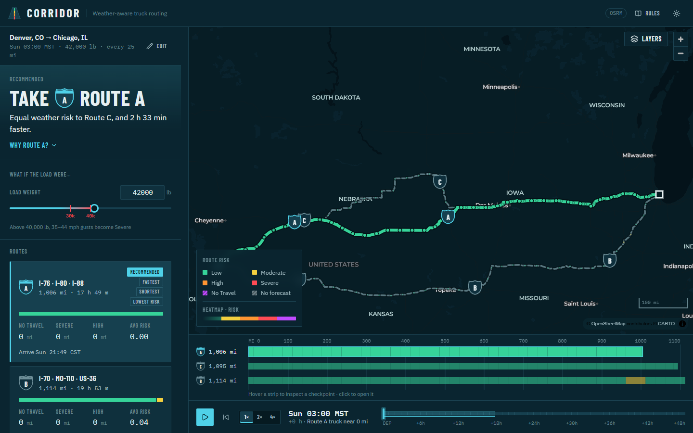
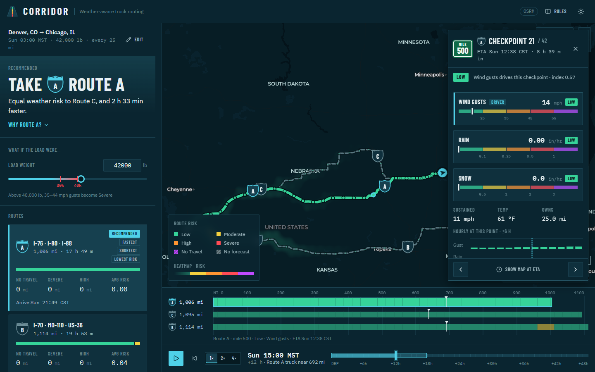
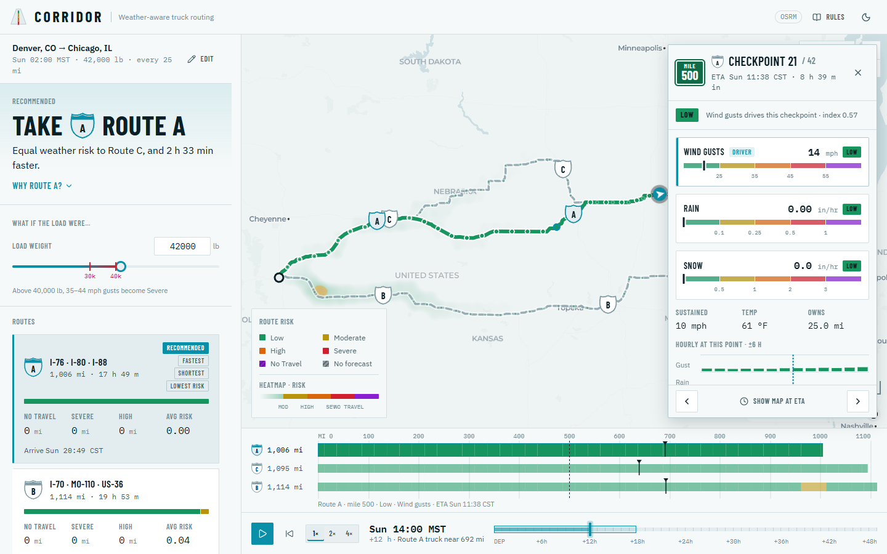
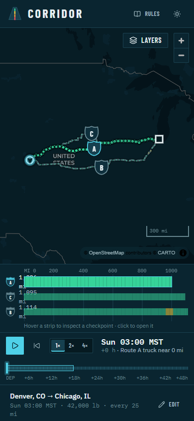
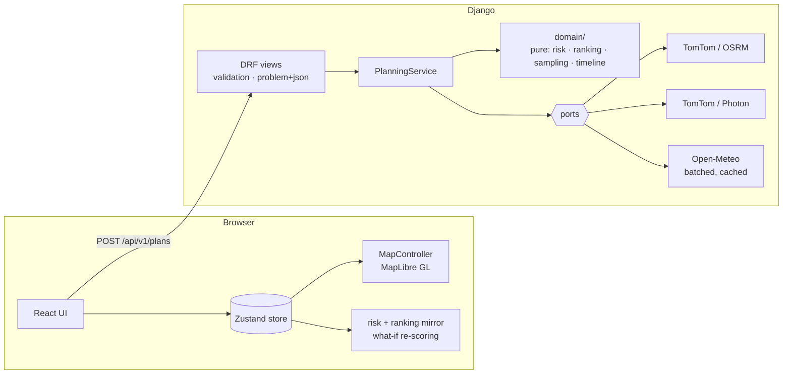

# Corridor

**Weather-aware truck routing.** Corridor plans three routes between two places and scores
every one of them by the weather the truck will actually drive into: the forecast at each
checkpoint *for the hour the truck gets there*, weighed against the load it is carrying.
It recommends the safest route and explains why in one sentence.



| Checkpoint detail (night) | Checkpoint detail (day) | Mobile |
| --- | --- | --- |
|  |  |  |

---

## What it does

- **Three distinct routes.** Provider alternatives, de-duplicated by overlap, topped up
  with perpendicular via-point detours when the router returns fewer than three.
- **Checkpoints every 10, 25 or 50 miles**, including both endpoints. Each checkpoint
  *owns* the road halfway to its neighbours, so route summaries count real miles.
- **Weather at the ETA.** ETAs follow the router's own speed profile (not a constant
  average); gusts are interpolated to the minute, precipitation is the rate for the hour
  that contains the ETA. Every checkpoint shows its ETA in its own local time zone.
- **Exact risk rules, load-aware.** Wind gust, rain and snow bands from the brief; ≥ 55 mph
  is No Travel for any load, 45–54 mph with > 30,000 lb is No Travel, 35–44 mph with
  > 40,000 lb is Severe. The worst factor sets a checkpoint's level.
- **Ranking** — fewest No Travel miles, then Severe, then High, then lowest mile-weighted
  average risk, then shortest time. The deciding criterion is named in the explanation
  ("50 fewer Severe miles than Route A").
- **What-if load.** Drag the load slider on the results page and every checkpoint, route
  summary, the recommendation and the heatmap re-score instantly, client-side, from the
  forecasts already in the response.
- **Corridor heatmap, 0–48 h.** A weather field around all three routes with a forecast
  slider and playback. Scrubbing changes one paint property — no requests, no re-upload.
- **Risk ribbon.** Every route as a strip of risk by mile on a shared axis, synced with map
  hover, showing where each truck is at the selected forecast hour.
- **Checkpoint drawer.** Factor gauges on the rule scales, the load rule when it applied,
  and ±6 h of hourly forecast — is this a passing spike or a long window?
- **Mandatory rest (hours of service).** Optionally plans FMCSA rest into the schedule — a
  30-minute break after 8 h of driving and a 10-hour rest after 11 h — so later checkpoints
  are scored at the hour the truck really gets there. Rest stops appear on the map and the
  ribbon, and the truck parks while it rests.
- **Unknown is never safe.** Miles without a forecast are shown hatched and counted as
  unknown, not as Low.

Keyboard: `←/→` forecast hour (`Shift` ×6) · `Space` play · `1/2/3` select route ·
`H` heatmap · `?` rules · `Esc` close drawer. Plans are shareable: the URL replays the trip.

---

## Quick start

Requirements: Python 3.12 with [uv](https://docs.astral.sh/uv/), Node 22 with pnpm 10.

```bash
# Backend — http://localhost:8000  (API docs at /api/docs)
cd backend
cp .env.example .env          # optional: add TOMTOM_API_KEY for truck routing
uv sync
uv run python manage.py runserver

# Frontend — http://localhost:5173  (proxies /api to :8000)
cd frontend
pnpm install
pnpm dev
```

Or the whole stack in containers on http://localhost:8080:

```bash
TOMTOM_API_KEY=... docker compose up --build
```

**No keys required.** Without `TOMTOM_API_KEY` the backend falls back to OSRM (car
profile — clearly labelled in the UI) for routing and Photon (OpenStreetMap) for place
search. Weather is Open-Meteo, which needs no key. With a TomTom key, routes are
truck-legal and use the truck's gross weight (load + 35,000 lb tare).

| Variable | Purpose |
| --- | --- |
| `TOMTOM_API_KEY` | Truck routing + search (recommended) |
| `OPEN_METEO_API_KEY` / `OPEN_METEO_BASE_URL` | Commercial Open-Meteo endpoint (optional) |
| `REDIS_URL` | Shared cache in production (LocMem otherwise) |
| `DJANGO_SECRET_KEY`, `DJANGO_ALLOWED_HOSTS`, `CORS_ALLOWED_ORIGINS` | Django deployment |
| `VITE_API_BASE_URL` | Frontend build: API origin when not served same-origin |
| `CORS_ALLOWED_ORIGIN_REGEXES` | Extra allowed origins by regex (e.g. Vercel previews) |

## Deploying (free)

Backend on **Render** (free web service + free Key Value), frontend on **Vercel** (free).
Push the repo to GitHub first.

1. **Backend.** Render → *New* → *Blueprint* → pick the repo. `render.yaml` creates
   `corridor-api` (Docker, `backend/`) and `corridor-cache` (Redis). Leave
   `CORS_ALLOWED_ORIGINS` blank for now. When it is live,
   `https://corridor-api.onrender.com/api/v1/health` returns `{"status":"ok"}`.
2. **Frontend.** Vercel → *Add New Project* → the repo, **Root Directory `frontend`**,
   environment variable `VITE_API_BASE_URL=https://corridor-api.onrender.com`
   (your Render URL, no trailing slash). `vercel.json` handles the rest.
3. **Connect them.** In Render set `CORS_ALLOWED_ORIGINS` to the Vercel URL
   (e.g. `https://corridor.vercel.app`) and save; it redeploys.

Free Render services sleep after 15 minutes idle and take about a minute to wake. The page
pings the backend as soon as it loads, so it is usually awake by the time a trip is
submitted. To keep it always warm, point a free uptime pinger (e.g. cron-job.org) at
`/api/v1/health` every 10 minutes; one service running all month fits the free hours.

---

## Architecture



**Backend** (`backend/corridor/`)

| Layer | Responsibility |
| --- | --- |
| `domain/` | Pure functions and value objects — risk bands, load rules, ranking, checkpoint placement, time profiles. No I/O, fully typed (`mypy --strict` style), property-tested. |
| `planning/` | The orchestrator. Fetches routes, places checkpoints, batches weather for checkpoints and the corridor grid, builds heatmap frames, ranks. Talks to providers only through `Protocol` ports. |
| `integrations/` | Provider adapters (TomTom, OSRM, Photon, Open-Meteo), HTTP retries, caching decorators, unit normalisation from `hourly_units`. |
| `api/` | Request serializers, response presenters, RFC 9457 error mapping, throttling, OpenAPI via drf-spectacular. |

**Frontend** (`frontend/src/`)

| Folder | Responsibility |
| --- | --- |
| `api/` | Types generated from `shared/openapi.yaml`, fetch client, TanStack Query hooks. |
| `domain/` | TypeScript mirror of the risk rules and ranking (parity-tested against the same cases as Python), formatting, heatmap frame decoding, timeline maths. |
| `state/` | Zustand store, memoised scored-plan selector, URL round-trip. |
| `features/` | `planner`, `results`, `map`, `timeline`, `ribbon`, `checkpoint`, `rules`. |
| `ui/` | Design-system primitives: route shields, mile markers, risk chips, segmented control. |
| `styles/` | Design tokens for the night and day themes. |

The map is driven imperatively by a `MapController` class: React passes it state, it owns
MapLibre sources and layers. High-frequency state (forecast hour, hover) reaches the map
through a store subscription, so scrubbing and hovering never re-render React.

### Logic parity

The risk rules live in two languages: Python decides, TypeScript re-scores for what-if
loads. Both test suites run the same table, `shared/risk_cases.json`, including every band
edge, the strict No Travel edges for precipitation, and both load rules. TypeScript
reproduces Python's banker's rounding where ranking keys are quantised.

---

## Testing & quality

```bash
cd backend  && uv run pytest && uv run ruff check . && uv run mypy
cd frontend && pnpm test && pnpm lint && pnpm typecheck && pnpm build
```

- **Backend:** 231 tests. Boundary tables and Hypothesis property tests for the domain,
  recorded provider payloads (respx) for integrations, and an API contract test that checks
  responses against the OpenAPI schema.
- **Frontend:** 116 Vitest tests for the risk/ranking mirror (shared parity cases), geometry,
  timeline and ribbon layout.
- **CI** (`.github/workflows/ci.yml`) runs all of the above and fails if the OpenAPI
  schema or the generated TypeScript types are stale.

---

## Key decisions

Each interpretation of the brief has an ID (D1–D25) that the code cites where it applies.
The ones that most affect results:

- **Gusts, not sustained wind**, drive the wind factor — gusts are what tip a high-sided
  trailer. Sustained wind is shown in the drawer.
- **Band edges.** Wind is lower-inclusive (≥ 55 is No Travel). Precipitation No Travel is
  strict (> 1.00 in/hr rain, > 3.0 in/hr snow), as written in the brief.
- **Load rules apply to wind only** and are reported on the checkpoint whenever they
  changed its level.
- **Owned miles** split at midpoints between checkpoints, so 25-mile sampling of a
  1,006-mile route sums to 1,006 miles.
- **No Travel miles are ranked before Severe** — a route that crosses a No Travel stretch
  never wins on fewer Severe miles.
- **Routing weight** is gross (load + tare); **risk** uses the load as entered.

## Limitations

- Without a TomTom key, routes come from a car profile and may use roads closed to trucks.
- Open-Meteo forecasts reach 15 days; departures are limited to 10 days ahead so every
  checkpoint ETA stays inside the forecast horizon.
- The heatmap shows forecast weather across the corridor at each hour; route risk uses
  each checkpoint's own ETA. They answer different questions and are labelled as such.
